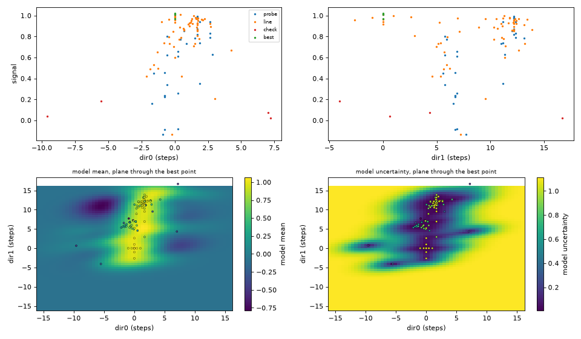

# Optimizing scans

Aligning a focusing setup means turning several knobs that act on the same
signal: the parabola translations, its tilts, the steering mirror in front of
it, and the delay, which has to follow every change of the path length. Done
by hand that is a long series of small scans, one knob at a time, with the
knobs pulling against each other. `scans.optimize` takes over that loop: you
name the knobs and a step for each, it maximises the signal, finds which
*combinations* of knobs matter, calibrates how the delay has to follow, and
checks whether a better maximum could hide elsewhere. Every point it measures
is an ordinary scan step, recorded by the DAQ like any other scan.

## Try it without hardware

`sim.thz_focus` simulates a THz focus at a probe spot: a parabola
(`par_x`, `par_z`, `par_rx`), a steering mirror before it (`mir_rz`,
`mir_rx`) and the probe `delay`, coupled as in the real setup (details in
{doc}`simulated_targets`). All axes start at 0, where the signal is about 0.2;
the best possible is 1.02.

```python
t = sim.thz_focus
s = scans.optimize(
    [t.par_x, 0.03], [t.mir_rz, 0.05], [t.delay, 0.08],
    exposure_def=0.2, feedback=t.signal,
    follow={t.delay: "calibrate"},
)
```

After about 100 points (30 s) it stops at a signal of 1.00 and prints what it
found:

```text
optimize: no clear maximum along sim.thz_focus.delay yet; calibrating later
optimize: cycle 1: 0.918 (gain +0.687, noise 0.02)
optimize: cycle 2: 0.9728 (gain +0.0548, noise 0.02)
optimize: cycle 3: 1 (gain +0.0276, noise 0.02)
optimize: calibrated: d(sim.thz_focus.delay) = +3.358*d(sim.thz_focus.par_x) +0.04321*d(sim.thz_focus.mir_rz); it follows from now on
optimize: cycle 1: 0.9912 (gain +0.0077, noise 0.017)
optimize: check: a better maximum is possible (bound 2.41 > best 0.991)
optimize: check: 1.01 where 0.0919 was expected -- searching around it
optimize: check: 5 check point(s) measured, none better (highest 1.012); 20 candidate(s) still allow a better maximum
optimize: best point measured 3x: 0.9999 +- 0.021
...
optimize: 99 points, best 1.012 (noise 0.017)
  sim.thz_focus.par_x            +0 -> +0.202751  (+6.76 steps)
  sim.thz_focus.mir_rz           +0 -> -0.0211966  (-0.42 steps)
  sim.thz_focus.delay            +0 -> +0.474657  (+5.93 steps)
  sim.thz_focus.delay follows: +3.358 per sim.thz_focus.par_x, +0.04321 per sim.thz_focus.mir_rz
  directions (curvature per step^2; components in axis units per step):
    dir0: -0.113   sim.thz_focus.par_x +0.00516, sim.thz_focus.mir_rz +0.0493
    dir1: +0.00861   sim.thz_focus.par_x -0.0296, sim.thz_focus.mir_rz +0.0086
  check: 5 check point(s) measured, none better (highest 1.012); 20 candidate(s) still allow a better maximum
```

- **calibrated**: at first the delay is too far from its best to calibrate.
  After the first local optimisation it is not, and from then on the delay
  follows the parabola by 3.36 ps per mm. The simulation's true value is
  1/c = 3.34 ps/mm. The 0.04 ps/deg for the mirror is nothing within the
  noise; it changes no path.
- **directions**: the two combinations of parabola x and mirror tilt that
  matter, with the delay following. `dir0` is steep (mostly mirror). `dir1` is
  flat: moving x against the mirror keeps the spot on the probe, and only the
  weak aberration of the off-axis incidence tells the points along it apart.
- **check**: one check point landed on that flat ridge, far from the measured
  points, at 1.01 where the model expected 0.09. A short search around it
  found nothing clearly better. The space is not exhausted after 5 check
  points ("20 candidates still allow a better maximum"); `check=30` covers it
  much better.

The scan ends sitting at the best point. Run the same with all six axes for a
full alignment (about 200 points).

With a shorter exposure (`exposure_def=0.05`) the noise is twice as high.
The run then still improves the signal, but the delay calibration needs a
clear maximum and may not happen, and along the flat ridges the point found
drifts with the noise. Exposure is the price of precision here, as in any
scan.

## Syntax

```python
scans.optimize(*axes, exposure_def=..., feedback=..., follow=None, limits=10,
               budget=None, max_points=None, repeats=3, pairs=True, max_step=4,
               cycles=4, check=5, restarts=1, plot=True,
               counters=[], settling_time=0, description="", queue=None)
```

| Argument | Meaning |
|---|---|
| axes | `[adjustable, step]`, `[adjustable, step, (low, high)]` or `[adjustable, step, low, high]` |
| `step` | a move that changes the signal clearly near the optimum, some 10 %. Everything is counted in it: probes are ±1 step, `limits` and `max_step` are in steps. |
| `exposure_def` | exposure per point, in the unit of the first counter (as for every scan) |
| `feedback` | the live signal to maximise: a detector, a counter, `(counter, channel)` or `f(scan) -> (value, error)`, as for {doc}`adaptive_scans` |
| `follow` | see below |
| `limits` | steps allowed around the start (a number, or one per axis), always within the adjustables' own limits. An explicit range in an axis spec replaces it. |
| `budget`, `max_points` | optional: time (`"10min"`) or point limit. The optimisation also ends by itself. If a limit ends it, the best point is measured once more (one point over). |
| `repeats` | measurements of each probe centre (noise) and of the final best point |
| `pairs` | probe axis pairs too (needed for the directions and the calibration). `False` costs much less for many axes but sees no couplings. |
| `max_step` | largest single move of a line search, in steps |
| `cycles` | line-search cycles per local optimisation |
| `check` | points measured afterwards where a better maximum is still possible (0: none) |
| `restarts` | how often a better maximum found by the check restarts the optimisation there |
| `settling_time` | wait after each move. Give one if the detector reports with a delay. |

## Delay that follows: `follow=`

The delay is coupled to the alignment: moving the parabola changes the THz
path, and the signal at a fixed probe delay drops long before the focus gets
worse. There are two ways to handle it.

**Calibrated** (`follow={delay: "calibrate"}`, the delay is one of the axes):
the delay is optimised like the other axes until the model has measured a
clear maximum along it, close to the current point. From then on its best
position is a linear function of the other axes, with coefficients from the
measured couplings. The delay is no longer searched; it moves along with every
step. The coefficients are printed, stored with the scan
(`scan_parameters["optimize"]["follow_coefficients"]`) and in
`s.optimizer.strategy.follow_coefficients`.

The calibration waits until the delay is near its best (within 0.3 steps):
further away the measured couplings are biased, because the signal is
field × waveform(delay) and the field changes look like timing there.
Starting far from time zero, it typically happens at the probe after the first
local optimisation, so the coefficients describe the optimum.

**Fixed** (`follow={delay: {t.par_x: 3.336, t.par_z: 3.336}}`, the delay is
*not* one of the axes): the delay moves by the given coefficient (delay units
per axis unit) times each axis' change from the start. Use this with
coefficients you know, for example from an earlier calibration. The delay's
own offset is not optimised then.

Several followers, and fixed followers next to a calibrated axis, are allowed.

## How it works

1. **Probe** the start: the centre `repeats` times (for the noise), ±1 step on
   every axis and, with `pairs`, both diagonals of every axis pair. A local
   quadratic model of the signal is fitted to these points. The eigenvectors of
   its curvature are the **directions**: coupled combinations of axes, sorted
   from the most to the least sensitive.
2. **Line searches** along these directions (first along the model's step to
   its maximum if it has one), in the style of RCDS (robust conjugate direction
   search, X. Huang, SLAC): steps grow until the signal is clearly (3 σ) worse
   than the best on the line, the bracket is filled, and a parabola through the
   points gives the line's maximum. Cycles are repeated while they gain more
   than 2 σ. Between cycles the model and the directions are refitted from all
   data near the new point.
3. **Probe again** at the optimum: the final model and directions, and the
   calibration if it was not done yet (then one more cycle with the delay
   following).
4. **Check** for a better maximum elsewhere: a Gaussian-process model through
   *all* measured points, which assumes that unexplored regions could hold
   anything between the lowest and the highest signal seen. One at a time, the
   point with the highest upper bound (mean + 2 σ of the model) within the
   limits is measured and the model refitted. A value well above what the model
   expected there (the flank of another peak) gets a short local search around
   it. A clearly better maximum restarts steps 1–3 from there.
5. **Best**: the best point is measured `repeats` times. The scan ends there.

A point whose own error is far above the typical one (samples mixed up with
the move, a beam drop) is measured once more.

The live plot shows every point coloured by phase (probe, line, check, best)
and the highest value so far.

## After the scan

`s.optimizer` (also `scans.acquiring_scan.optimizer`):

| | |
|---|---|
| `s.optimizer.summary()` | the printout above |
| `s.optimizer.best()` | `{adjustable: value}` of the best point |
| `s.optimizer.move_to_best()` | go back there |
| `s.optimizer.virtual_axes()` | the directions as adjustables, in steps from the best point. Followers move along: `d = s.optimizer.virtual_axes(); d[1].tweak()` aligns by hand along the flat direction. |
| `s.optimizer.landscape()` | the measured field (below) |
| `s.optimizer.strategy.unexplored` | the points where the check still allowed a better maximum |

`landscape()` draws the signal of every point against its projection on each
direction (the "shadow" of the N-dimensional field), and the model's mean
and uncertainty on the plane of the two strongest directions through the best
point (`landscape(dims=["par_x", "mir_rz"])` for two axes instead):



A slice can hide a maximum off its plane; the uncertainty map shows where the
data is thin. The check's verdict says whether candidates for a better
maximum remain: `none better ...; the model now allows no clearly better
maximum`, or `... N candidate(s) still allow a better maximum` if `check` ran
out. In six dimensions a handful of check points cannot cover the space; the
second answer is the honest one there, and `check=30` buys more certainty.

## What is recorded

The scan is an ordinary step scan: DAQ files, run table, elog. Its points are
not on a grid, so the scan's mesh (`scan_parameters["mesh_specs"]`, see
{doc}`multidim_scan_data`) has kind `path`, one dimension per adjustable
(followers included) and a resolution of a tenth of each step. escape loads
it with `arr.mesh` like any other scan. `scan_parameters["optimize"]` holds the
axes, steps, start and best point, the noise, the phase of every point, the
directions and the follow coefficients.

## On the beamline

For the THz chamber (`thc`), with an EO signal as feedback:

```python
scans.optimize(
    [thc.x, 0.03], [thc.z, 0.05], [thc.rx, 0.02], [thc.inc_rz, 0.01],
    [thc.delay_thz, 50e-15],
    exposure_def=200, feedback=eos_signal,
    follow={thc.delay_thz: "calibrate"},
    settling_time=0.2, budget="20min",
)
```

The steps here are placeholders: choose them so that one step changes the
signal by roughly 10 % near the optimum. Too small, and the curvature drowns in
the noise. Too large, and the probe already leaves the peak.
