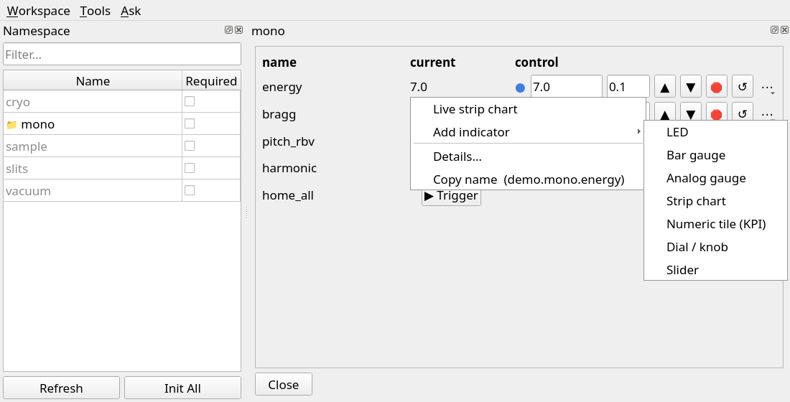
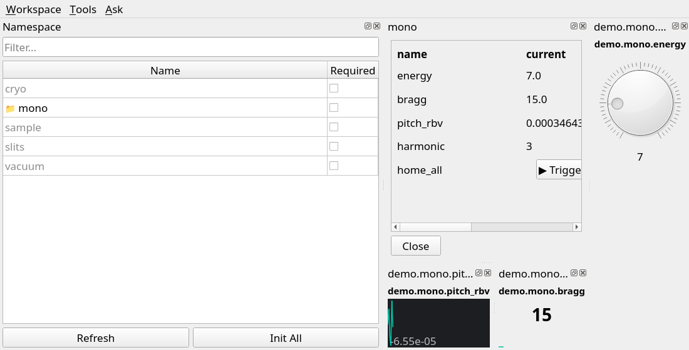
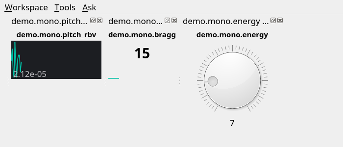
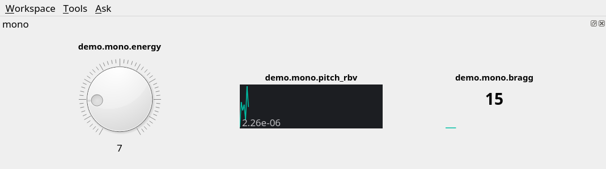

# Build a simple GUI in eco desktop

Sometimes a whole device panel is too much and a terminal is too little: a
control-room screen with a knob for the photon energy and a live trace of the
mirror pitch, or a few gauges for a user who should see the sample
temperature but nothing else. eco desktop builds such a panel by pointing and
clicking, without writing code. The result is saved as one shell script that
opens just that panel. Only the devices it shows are initialized, so it starts
quickly.

In short:

1. Start `eco desktop`.
2. Open the devices you need from the Namespace panel.
3. Turn single values into gadgets (dial, LED, gauge, strip chart, ...).
4. Close everything you don't want.
5. Arrange and resize; optionally lay it out in Qt Designer.
6. Save a startup script.
7. Start the panel from that script.

The screenshots below were taken with simulated devices (`demo.mono`,
`demo.slits`, ...). On the beamline the same steps work with `bernina.<device>`.

## 1. Start eco desktop

```bash
eco desktop -s bernina
```

The window has a **Namespace** panel on the left, listing every component of
the scope, and the console on the right. Grey names are not initialized yet
(lazy); nothing is built until you click it. See {doc}`launching` for the
other options.

## 2. Open the devices you need

Click a device in the Namespace panel. It is built in the background (a
spinner shows meanwhile), and its property grid docks into the window. The
grid has one row per value, with the readback and, for adjustables, the
controls.

A row that is itself a device (a sub-assembly) opens that device's own grid
when you click it, docked next to the first one. That's how to get a small
grid of, say, `mono.crystal` instead of all of `mono`.

## 3. Turn values into gadgets

Every row ends with a **⋯** button. **⋯ → Add indicator** offers seven gadgets:



| Gadget | Good for |
|---|---|
| **LED** | on/off states: shutters, valves, interlocks |
| **Bar gauge**, **Analog gauge** | a value against its range |
| **Strip chart** | a value over the last minutes |
| **Numeric tile (KPI)** | one big number with a small trend line |
| **Dial / knob** | setting a value by turning, or choosing between named states (e.g. a filter wheel) |
| **Slider** | setting a value along its range |

The gadget is docked into the window like a grid. Dials and sliders move the
device when you let go of them (only for values that can be set; for
read-only values they just follow). The range is taken from the device's
limits; see [the Designer section](designer) for changing it.

The same menu also has **Live strip chart** (a larger rolling plot),
**History** (the archiver's record), and **Open → ...** (a device's own extra
views, e.g. a camera image). These dock into the window as well and are
saved like everything else.



## 4. Close what you don't want

Close the Namespace panel, the console and the full device grids with the
**×** in their title bars. Gadgets keep working when their device's grid is
closed; the device stays initialized.

Closing a panel is final for the panel, not for the device: re-open it from
the Namespace panel. **Workspace → Show Namespace Panel** brings that panel
back after you closed it. A closed console cannot be reopened in the same
window.

## 5. Arrange and resize

- Drag a panel by its title bar onto an edge of another panel to place it
  next to it, or onto its title bar to stack them as tabs.
  **Tools → Combine Panels into Tabs...** does the same from a list.
- Drag the thin gap between two panels to share the space differently.
- Resize the window itself to the size the panel should have.
- The float button in a title bar turns a panel into its own window. Its
  position is saved too.



(designer)=
## 6. Optional: lay out the gadgets in Qt Designer

Docked panels can only sit in rows, columns and tabs. For a freer layout, with
headings, frames, a grid of gadgets or spacing, use Qt Designer:

1. **Tools → Edit Gadgets in Qt Designer...** and choose a file name (the
   default folder is `~/.eco/custom_panels/`). eco writes every gadget that is
   docked in the window into that `.ui` file and opens Designer on it.
2. In Designer, each gadget is an **empty, labelled box**, shown at its
   size. Designer cannot run eco's Python widgets, so it shows no live values.
   Arrange the boxes: select them and use **Form → Lay Out in a Grid** (or
   *Horizontally*/*Vertically*), add labels, group boxes or spacers from the
   widget box, resize.
3. Don't change a box's class, its *accessibleName* (the device path), or the
   dynamic properties *ecoKind* and *ecoKwargs*: eco rebuilds the gadget from
   them. The one exception: to change a dial's, slider's or gauge's range,
   edit *ecoKwargs* in the property editor, e.g. `{"vmin": 5.0, "vmax": 12.0}`.
4. Save (**Ctrl+S**) and go back to eco desktop.
5. **Tools → Load Designer Panel (.ui)...** and pick the file. It is docked
   as one panel, and each box becomes a live gadget as soon as its device is
   initialized. Close the separate gadget docks it replaces.



The panel is saved by its file path, so a later change in Designer shows up
the next time the panel is started. Keep the `.ui` file where it is, or in a
shared folder if others start the panel too.

## 7. Save the startup script

**Workspace → Save Startup Script...** and choose a name, e.g.
`~/mono_panel.sh`. The script is a single file that holds the following:

- the window size and position, and the arrangement and sizes of all panels;
- the device grids, sub-device grids, strip charts, history and other views
  that are open;
- the gadgets, with their device, kind and range;
- the Designer panels (by file path);
- whether the console and the Namespace panel are shown (closed ones stay
  closed);
- the scope, lazy loading and the theme.

Panels you closed are not in it.

## 8. Start the panel

```bash
~/mono_panel.sh
```

This opens the desktop with exactly that panel. It does the following:

- It initializes only the devices the panel shows, in the background. Each
  gadget comes alive when its device is ready. Everything else in the
  namespace stays lazy, so the panel is up in seconds, not after a full
  namespace start.
- It doesn't open a device's whole grid just because one of its gadgets is
  shown.
- It puts back the saved layout as the pieces arrive.

Options after the script name are passed on to `eco desktop`, e.g.
`~/mono_panel.sh --touch` for a touch screen, or `--theme dark`.

The script runs the Python and the eco checkout of the session that saved it,
so it works from any shell, even one where the Bernina environment isn't
activated. Its last line shows which ones they are. A script saved on a
beamline console works on the other consoles. Save it again from the target
machine to move it elsewhere.

To change the panel later, start it, change it, and save the startup script
again under the same name. **Workspace → Show Namespace Panel** gives you the
device list to add more. If you need the console, delete `--no-console` from
the script's last line before starting it.

## Good to know

- If a device can't be initialized when the panel starts (IOC down), its
  gadgets and views are left out with a warning in the terminal; the rest of
  the panel comes up.
- Each gadget reads its value twice a second in its own thread; a panel with
  a few dozen gadgets is fine.
- **Workspace → Reload Last Workspace** brings back the layout that was saved
  when the window last closed. It saves the same things as the startup
  script, but keeps them in `~/.eco/desktop_workspace.json` for your account
  instead of a file to share.
- The separate **dashboard window** (`eco.widgets.dashboard_qt.Dashboard`)
  still exists for gadgets added from a grid that isn't docked in eco desktop,
  e.g. a `.widget()` opened from a terminal session. It has its own Workspace
  menu, Designer export and Python script export, but not this startup script.
- Not saved: the console's contents, and the scan launcher, log viewer and
  Ask panels.

## See also

- {doc}`launching`: the `eco desktop` options and the Workspace menu.
- {doc}`widget_views`: the grid rows and the gadgets in more detail.
- {doc}`widget_containers`: building a panel in code instead.
