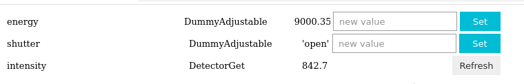

# Adjustable/Detector widget views

Every {py:class}`~eco.elements.protocols.Adjustable` or
{py:class}`~eco.elements.protocols.Detector` in an assembly can be looked at
live from either front end — the Qt desktop workbench or a browser
(JupyterLab/Voila, via ipywidgets). Both build one row per item from the same
underlying `get_current_value()`/`set_target_value()` interface, but they are
two independent implementations with different capabilities, described below.

## Default per-item row

### Qt desktop (`eco.widgets.display_qt`)

The desktop app's dockable property grid ({py:class}`~eco.widgets.display_qt.DisplayQt`,
also used standalone via `make_assembly_qt_window`) shows a **name / current /
control** row per item. Items that can push updates (motor records, PV-backed
adjustables and detectors) are monitored and show changes at once; the rest
are polled in parallel on background threads:

- **Detector-only** items are read-only text — no controls.
- **Numeric Adjustables** get, from left to right: the absolute-value
  entry (the setpoint, right next to the readback), a step-size field, ▲/▼
  tweak buttons (move relative to the *live* current value, not the
  last-displayed one), and 🛑 Stop / ↺ Reset (back to the value from when the
  row was built).
- **Enum-valued Adjustables** (anything exposing `enum_strs`, e.g.
  `AdjustablePvEnum`) get a dropdown instead of step/absolute controls, same
  Stop/Reset pair.
- The **tweak step** of a motor record (and the SmarAct records) starts from
  the IOC's own tweak value (TWV), and editing it sets TWV. For other
  adjustables it starts from the adjustable's own tweak step if one was set
  up, else 1 or 0.1.
- A **status dot** at the start of the controls shows what the row is doing:
  grey — no value yet (connecting); orange — sending or moving; green —
  connected and monitored; blue — connected and polled; red — not connected,
  failed, or blocked (e.g. the adjustable is used by a running queue task).
  Hover over it for the reason.
- **Writes never block the window**: a click starts the move in the
  background, so the window stays responsive and 🛑 Stop works during the
  move. Opening waits at most 2 s for initial values; a row still connecting
  gets its controls when its value arrives.
- Every row ends in a small **⋯ menu** (also on right-click of the name) —
  see [the item menu](#the-item-menu) below.

In JupyterLab and Voila, a device's `.widget()` is the ipywidgets version of
the same grid (`eco.widgets.display_widget`). It follows the same rules:
- the same status dot (hover for the reason);
- monitored rows;
- the tweak step from TWV;
- clicks that never block the kernel, so 🛑 Stop works during a move;
- values that keep updating in the browser while a cell runs.

### The item menu

Every row of both grids — Adjustable, Detector or sub-assembly — ends in a
**⋯** button with what makes sense for that item
(`eco.widgets.item_menu`; Qt: `item_menu_qt`, ipywidgets: `item_menu_ipy`).
Entries only appear when the item supports them:

| Entry | What it does |
|---|---|
| **Open** | every `_widget_*` view of the item (property grid, tweak panel, viewer, SVG panel, …), the `widget()` default first |
| **Live strip chart** | a rolling time plot of `get_current_value()`, monitored where possible, polled otherwise; window 30 s – 1 h, pause, clear. Works for anything readable, EPICS or not |
| **Strip plot window (archiver)** | the archiver's `strip_plot()` in its own process — full dispatcher/EPICS rate, record, save. Qt, or a notebook kernel with a display |
| **History (archiver)** | `get_archiver_time_range()` for the last 10 min / 1 h / 12 h / 2 days / 7 days, fetched in the background |
| **Add indicator** | an LED / gauge / tile / … gadget (see below) — onto the dashboard in Qt, below the row in a notebook |
| **Memories** | the item's own memory browser, if it has one |
| **Details** | full name, class, value, unit, limits, states, channels (PV names), views, doc |
| **Copy name / Copy PV names / Find IOC** | Qt only |

In eco desktop, what the menu opens docks next to the grid it came from;
otherwise it gets its own window. In JupyterLab/Voila it appears as a
closable panel right below the row, in the same page — closing it stops its
reads. The menu is built from class-level lookups only, so it costs nothing
for rows nobody clicks; whatever needs hardware or the archiver runs in the
background.

### ipywidgets (`eco.widgets.assembly_browser`)

The browser-side namespace/assembly browser used by the `lab`/`voila`
front ends builds each row as a plain ipywidgets `HBox`
({py:class}`~eco.widgets.assembly_browser._ItemWidget`):

- Name, Python type, and `repr()` of the current value are always shown.
- **Adjustables** get a free-text entry plus a **Set** button (best-effort
  type coercion against the current value — bool/int/float/fallback JSON);
  there is no step/tweak concept here, no Stop, and no live polling — value
  updates only on explicit **Refresh** (Detectors) or after a successful
  **Set** (Adjustables).
- **Detectors** get a **Refresh** button only.

This is a simpler, more manual sibling of the Qt row — it works anywhere a
kernel/comm can reach a browser (including Voila, with no desktop Qt
involved) but does not poll live and has no notion of enum dropdowns, tweak
steps, or in-flight move stopping.

## Indicator / gadget widgets

For a LabVIEW-style live panel — LEDs, gauges, dials — instead of a grid row,
eco provides small standalone gadgets, one per item. The current direction is
a **matched, as-simple-as-possible pair**, one module per backend, both built
entirely from each toolkit's own stock controls (no new dependency, no
custom-painted graphics) and sharing the same function names/signatures so
either is a drop-in for the other:

- {py:mod}`eco.widgets.indicator_widgets_ipy` — ipywidgets (`lab`/`voila`)
- `eco.widgets.indicator_widgets_qt_simple` — Qt desktop

*ipywidgets — `eco.widgets.indicator_widgets_ipy`*

![The same seven gadgets on the Qt side, built from plain QWidgets: a green circular QPushButton for shutter_open, a vertical QProgressBar for pressure, a horizontal QProgressBar for energy, a QProgressBar plus a "value [lo .. hi]" label for intensity, a large QLabel for counts, a row of checkable QPushButtons for mode's enum choices, and a QSlider for position.](images/widget_indicator_gadgets_qt_simple.png)

*Qt — `eco.widgets.indicator_widgets_qt_simple`*

| Gadget (same name, both modules) | ipywidgets control | Qt control | Notes |
|---|---|---|---|
| `led_indicator` | `Button` (`button_style`) | `QPushButton` (stylesheet) | click to toggle if settable; a plain label/HTML can't take a click back |
| `bar_gauge` | `FloatProgress` | `QProgressBar` | vertical or horizontal fill against `[vmin, vmax]` |
| `analog_gauge` | `FloatProgress` (horizontal) | `QProgressBar` (horizontal) | **approximation** — no needle; see below |
| `strip_chart` | `FloatProgress` + label | `QProgressBar` + label | **approximation** — position within the min/max seen so far, not a rolling line; see below |
| `numeric_tile` | `HTML` | `QLabel` (enlarged font) | large number, no sparkline (same reasoning as `strip_chart`) |
| `dial` | `ToggleButtons` (enum) / `FloatSlider` (numeric) | checkable `QPushButton` row (enum) / `QSlider` (numeric) | enum case shows every choice at once; dragging a value in a circle isn't idiomatic UX on either toolkit, so the numeric case reuses the slider rather than faking a knob |
| `slider` | `FloatSlider` | `QSlider` | writes on release if settable |

Five of the seven are exact stock-widget matches on both sides. The other two
(`analog_gauge`, `strip_chart`) are deliberately left as plain bar/value
approximations rather than reaching for a new dependency — see either
module's docstring. If a real needle gauge or a real rolling plot is wanted
later, the candidates worth reviewing first:

- **Plotly `go.Indicator`** (`mode="gauge+number"` for the needle gauge,
  `mode="number+delta"` for a nicer KPI tile) — its `FigureWidget` is a real
  `ipywidgets.DOMWidget`, so it drops straight into the same `VBox`/`HBox`
  rows these gadgets already use, and updates live via
  `fig.data[0].value = x`. The single-best "one new dependency, covers both
  gaps" option.
- **bqplot** — a proper live-updating line plot (`Lines`/`Figure`) for
  `strip_chart`; itself a real Jupyter widget, no needle-gauge support.
- **Panel** (`panel.widgets.indicators.Gauge`/`Dial`/`BooleanStatus`) — the
  closest visual match to the Qt gadgets overall, but a separate framework
  built on Bokeh; its `pn.ipywidget()` bridge into plain `ipywidgets`
  layouts has known rough edges (no JS-linking, some nested-container
  issues), and it pulls in Bokeh as a second rendering stack.
- **anywidget** — the modern, low-effort way to wrap any JS/web-component
  (e.g. a real rotary-drag knob, a glowing LED) as a first-class Jupyter
  widget, if a literal LabVIEW look is ever wanted beyond what the above
  give. Worth knowing about, not needed for anything on this page.

Neither module has a discovery UI yet ("right-click a name → add gadget" on
Qt, or an equivalent on the notebook side) — call the function directly for
now, e.g. `eco.widgets.indicator_widgets_ipy.bar_gauge(my_assembly.pressure, vmin=0, vmax=100)`
or the equivalent `eco.widgets.indicator_widgets_qt_simple.bar_gauge(...)`.

### The older, hand-painted Qt gadgets

`eco.widgets.indicator_widgets` — the original, richer Qt-only module (real
needle gauge, a radial mode-select dial face, a live rolling strip-chart) —
still exists and is unrelated to the simple pair above, not superseded by
it. It's wired into the desktop app's right-click **"Add indicator"** menu
and a droppable {py:class}`~eco.widgets.dashboard_qt.Dashboard`, and its
gadgets double as valid Qt Designer "promoted widgets":

See its module docstring for the full gadget list and
`eco.widgets.indicator_widgets.attach_indicator_menu` for how it's wired
into `eco.widgets.display_qt`'s property grid. Reach for this one if the
simple pair's two approximations (no needle, no rolling line) actually
matter for a given panel; otherwise the matched simple pair above is the
current default recommendation for new work, on either backend.
